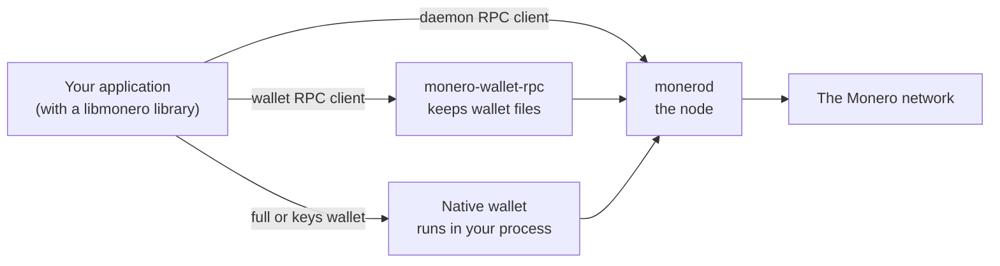

# How the pieces fit

Monero has a node, a wallet, and your application. The libraries are the part that lets your application talk to the other two, in the language that it is written in.

## The node

`monerod` is the node. It downloads and checks the whole chain, and relays transactions to the network. It knows the chain, but it knows nothing of who owns what: its funds, its keys and its accounts are not its business. A [daemon client](../examples/daemon/index.md) asks it about blocks, transactions, the pool, its peers and its own state.

A node that you run is yours: you trust what it says. A node that someone else runs, such as a public one, can see which IP address asks for what, and can lie about the chain. Public nodes also serve a restricted RPC, which refuses the calls that change the node.

## The wallet

A wallet holds the keys, and finds in the chain what belongs to them. It cannot see the chain by itself: it asks a node, and reads the blocks that the node gives it. The libraries have it in two ways:

* A **[wallet RPC](../examples/wallets/rpc.md)** is a client of a `monero-wallet-rpc` server. The server is a separate program that keeps the wallet files and the keys, syncs the wallet with a node, and answers calls. It has one wallet open at a time. Your application never holds the keys.
* A **[native wallet](../examples/wallets/index.md)** runs in the process of your application, through the native code of Monero. A full wallet has its files and syncs with a node. A keys wallet has only the keys, and needs no node.

Both conform to the same interface, so the code that makes a transfer is the same. The choice is about where the keys live, and what you want to run.

## Your application

Your application uses a library of its language: Python, Java, Kotlin, C#, C++ or C. They all have the same model of the data and the same names of the calls, so what you learn in one carries to the others. The libraries share the code that does the work, as the [architecture](../index.md#architecture) of the project shows: C++ and C hold it, and the others are bindings to it.

## What is where

| Question | Ask |
|----------|-----|
| Is this block in the chain? How many outputs are there? Is this key image spent? | the node |
| How much does this wallet hold? Where did these funds come from? | the wallet |
| What does this transaction cost? | the node estimates the fee, and the wallet makes the transaction |
| Did this payment arrive? | the wallet, with a [listener](../examples/notifications.md) |
