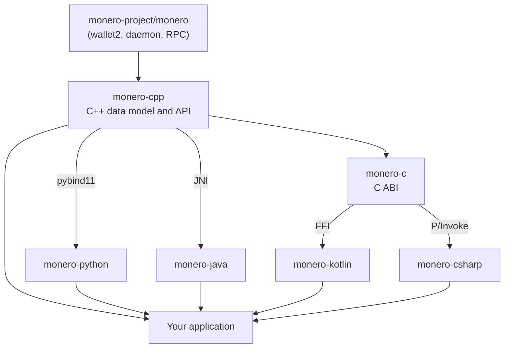

**Libraries for building Monero applications, in the language you already use.**

[Libraries](libraries.md){ .md-button .md-button--primary }
[Examples](examples/index.md){ .md-button }
[GitHub](https://github.com/libmonero){ .md-button }

Libmonero maintains a family of Monero libraries that share one thing: the same **data model and API**. Learn it once, and the wallet, the daemon, the transactions and the listeners look the same in C++, C, Python, Java, Kotlin and C#.

!!! warning "Status"

    Most of these projects are **under development and unfunded**. Expect bugs and breaking changes, and read the status notice at the top of each repository before depending on it. Wallets handle real funds: test on stagenet or testnet first.

## What every library gives you

-   **One clearly defined [data model and API specification](https://github.com/libmonero/monero-python/blob/main/docs/monero-spec.pdf)**, intended to be intuitive and robust, and implemented the same way in every language.
-   **RPC clients and native bindings.** Talk to `monerod` and `monero-wallet-rpc`, or run a fully client-side wallet on top of [monero-project/monero](https://github.com/monero-project/monero) `wallet2`.
-   **Interchangeable implementations.** A wallet backed by RPC and a wallet backed by native bindings conform to the same interface, so you can swap one for the other without rewriting your application.
-   **Multisig, view-only, offline and keys-only wallets.**
-   **Query and listen.** Find transactions, transfers and outputs by their properties, and receive notifications when blocks are added or when a wallet syncs, sends or receives.
-   **Tested against real daemons and wallets**, with unit and integration tests in CI.

## Architecture

[monero-cpp](https://github.com/libmonero/monero-cpp) wraps Monero's `wallet2` and defines the data model. [monero-c](https://github.com/libmonero/monero-c) exposes it as a C ABI, so any language with an FFI can build on it. Python and Java bind to monero-cpp directly. Kotlin and C# bind to monero-c.
